<p align="center">
  
</p>

<h1 align="center">Paint Anytime</h1>

<p align="center">
  A drawing app made specifically for Apple Watch.
</p>

<p align="center">
  Sketch an idea, doodle while you're waiting, or create a tiny piece of art right from your wrist.
</p>

<!-- <p align="center">
  <a href="https://apps.apple.com/app/paint-anytime/id6816100087?platform=watch">
    
  </a>
</p> -->

<p align="center">
  <a href="https://apps.apple.com/app/paint-anytime/id6816100087?platform=watch">
    
  </a>
  &nbsp;&nbsp;
  <a href="https://testflight.apple.com/join/ByhPwH11">
    
  </a>
</p>

<p align="center">
  <a href="https://github.com/denis-kolchev/Paint-Anytime/releases/latest">
    <strong>Latest Release</strong>
  </a>
</p>

## Screenshots
### Apple Watch
<table>
  <tr>
    <td align="center">
      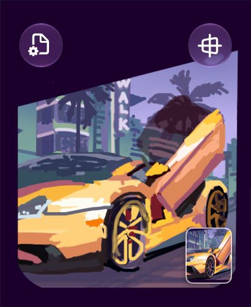
    </td>
    <td align="center">
      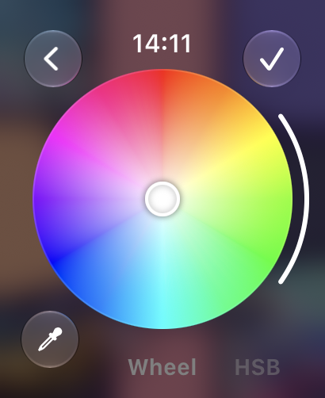
    </td>
    <td align="center">
      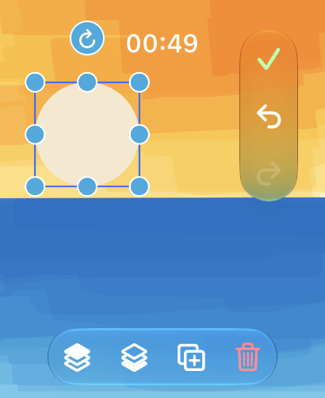
    </td>
    <td align="center">
      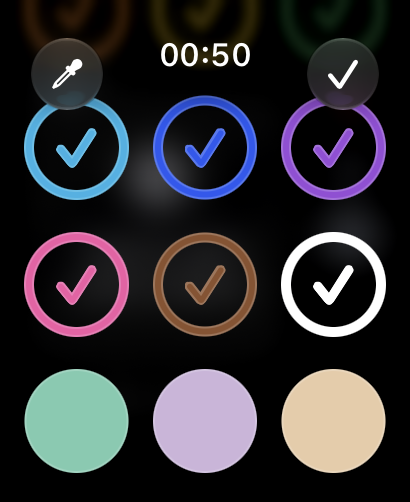
    </td>
  </tr>
  <tr>
    <td align="center">
      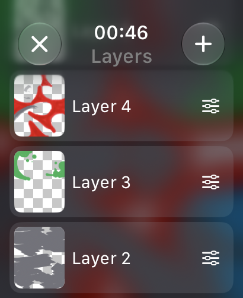
    </td>
    <td align="center">
      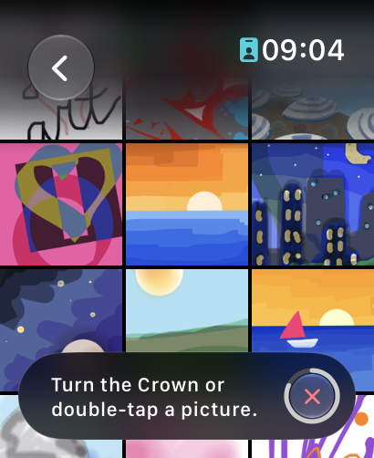
    </td>
    <td align="center">
      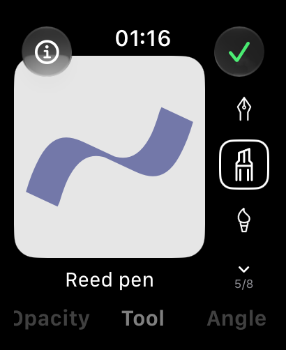
    </td>
    <td align="center">
      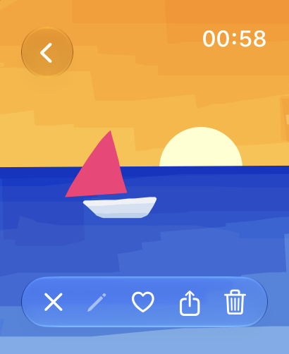
    </td>
  </tr>
</table>

### iPhone
<table>
  <tr>
    <td align="center">
      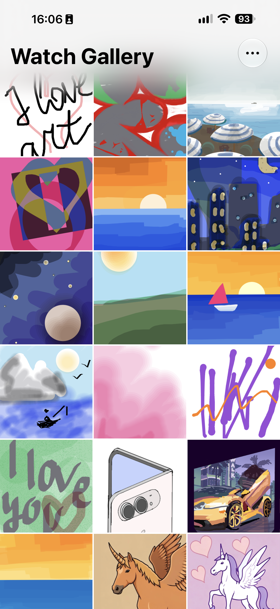
    </td>
  </tr>
</table>

### iPhone Duo
<table>
  <tr>
    <td align="center">
      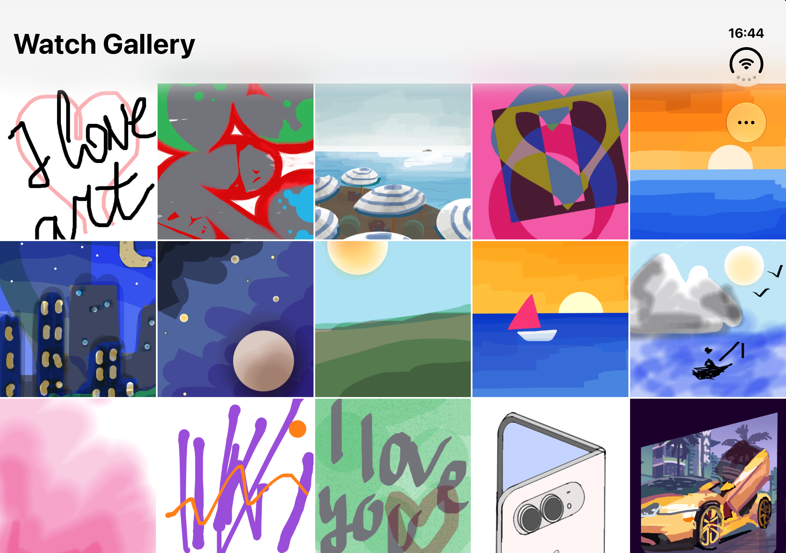
    </td>
    <td align="center">
      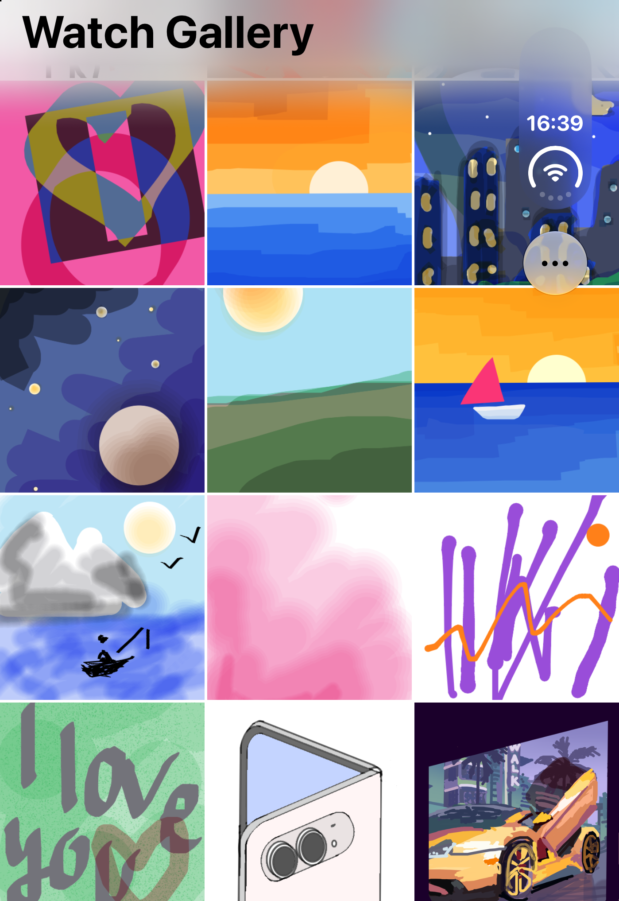
    </td>
  </tr>
  <tr>
    <td align="center">
      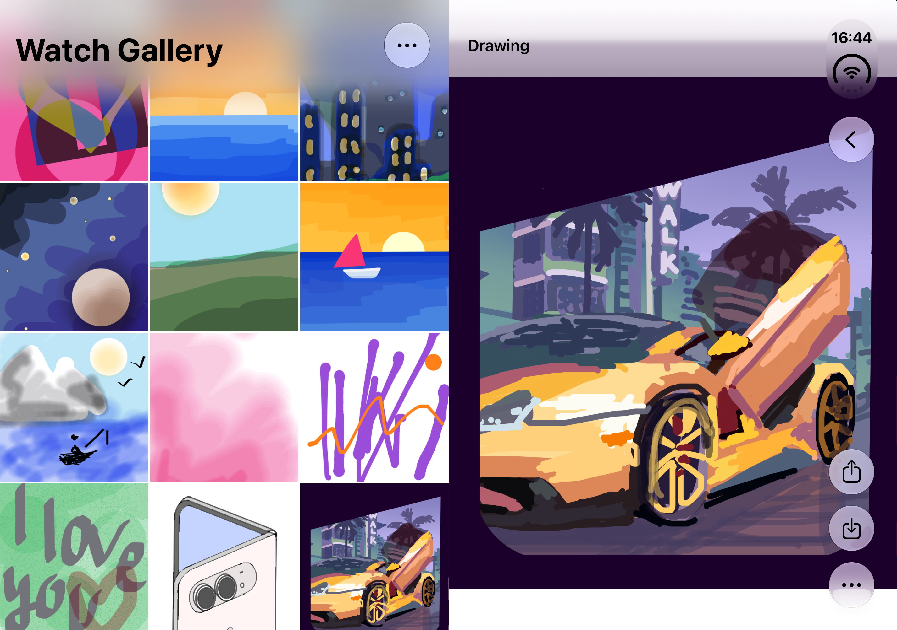
    </td>
    <td align="center">
      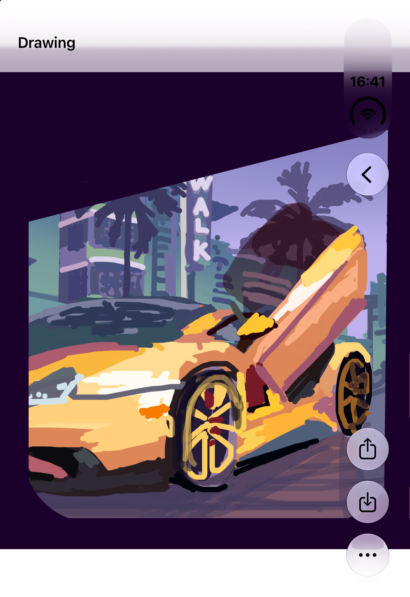
    </td>
  </tr>
</table>

## Description

Paint Anytime is for anyone who wants to draw anywhere, anytime. A vector canvas with no loss of quality, 8 brushes, layers, lasso, perspective guides and shape recognition — and Apple Intelligence turns your sketch into a detailed artwork.

It suits both first-time artists and those who draw every day: the interactive tutorial covers the basics in a couple of minutes, and the advanced tools will be waiting whenever you're ready.

## Features

### BRUSHES AND TOOLS
* 8 brushes familiar from the Apple ecosystem — each with its own behavior
* Adjust color, sensitivity and opacity
* Tilt angle for the reed pen
* Blur brush: strength, width and radius
* An eraser that works pixel by pixel or removes whole objects
* 14 color blending modes for strokes
* Shared width, density and color across all tools — if you like

### COLOR AND PALETTES
* Color wheel, eyedropper, HSB and RGB
* Your own palettes: add, delete and reorder colors and the palettes themselves
* Unique palette names inspired by their colors
* Hide built-in and custom palettes you don't use

### LAYERS AND LASSO
* Create, delete and reorder layers
* Opacity, visibility and layer lock — color without going outside the lines
* Lasso selection by shape or by stroke
* Move, rotate, mirror and duplicate a selection
* Move a selection to another layer or delete it

### SMART HELPERS
* Apple Intelligence: from sketch to detailed artwork
* Recognition of 15 shapes: line, arc, circle, ellipse, square, rectangle, triangle, polygon, star, heart, cloud, callout and three kinds of arrows
* Perspective guides with 0, 1 or 2 vanishing points, even beyond the canvas
* Adjust the angle, tilt, number of rays and distance between vanishing points
* Straight lines along a ray or a ruler
* Up to 256 undo steps

### REFERENCE
* Keep a reference image next to the canvas or overlay it and switch back
* Pick colors right from the reference with the eyedropper
* Zoom up to 800%, kept when you return to the canvas
* Show and hide the reference with a single tap

### CANVAS
* Zoom up to 51,200%
* Size up to 2048 × 2048 pixels
* Resize by percentage or by width and height, keeping proportions
* Extend horizontally and vertically, rotate and crop
* Vector drawings scale without losing quality (except blurred areas)
* Three display modes: Smooth (vector), Pixels (as in the final file) and Auto
* Your own layout: arrange and group buttons, pick a group icon from 20 options, or reset everything

### GALLERY AND FILES
* Grid from 5×5 to 1×1
* Favorites, editing and deleting
* Share via Messages and Mail right from your watch
* Select several artworks at once to favorite, share or delete them
* Sync with your iPhone gallery
* Import from Photos and Files
* PSD, JPG, PNG and the native .paintanytime format

### AUTOSAVE
* Your work is saved in the background
* Interval from 1 to 10 minutes
* Show or hide the autosave timer

### WIDGETS
* Quick access: open the app, the gallery or jump straight to a new canvas
* Your artwork on the Home Screen: random drawings from the gallery or favorites, 1 to 3 per widget

### TUTORIAL
* Interactive lessons with hints
* Basic course: how to change color and brush and save a drawing to the gallery
* Advanced course: color blending, lasso, layers, shape recognition, canvas editing, creating colors and palettes
* Progress is saved — pick up right where you left off

### MORE
* iPhone Duo support


## What's New in 1.2.0

### NEW FEATURES

* Zoom up to 51,200% instead of 800%. The limit is dynamic and depends on the canvas size: you can zoom in until a single pixel of your artwork fills a noticeable part of the screen — beyond that there's nothing more to see. Even a small canvas goes up to at least 3,200%. The current zoom level is shown right on the screen.
* Resize the canvas up to 2048 × 2048 pixels, by percentage or by width and height while keeping proportions. Rotate, crop and extend the canvas, all in one menu.
* New Pencil and Crayon brushes with a lively texture.
* Blur brush for soft edges and smooth gradients, with adjustable strength, width and radius.
* Perspective guides with 0, 1 or 2 vanishing points — even beyond the canvas. Adjust the angle, tilt, number of rays and distance between points, and draw straight lines along a ray or a ruler.
* Apple Intelligence turns your sketch into a detailed artwork (requires an iPhone with iOS 18.2 or later).
* Reference: keep an image next to the canvas or over it, pick colors from it with the Eyedropper and zoom it up to 800%.
* Up to 256 undo steps instead of 30. Simple actions use little memory, so you can undo further back. Heavy ones — erasing, blurring, working with photos — use more, so the history gets shorter, but never below 30 steps. This keeps the app within the watch's memory limit so watchOS doesn't close it.
* The Lasso can now mirror a selection and has a handle for moving it.
* Canvas editor: arrange and group the buttons on the canvas your way, pick a group icon, or reset everything with one tap.
* Choose the canvas color from the current palette.
* Color wheel and Eyedropper in the color settings.
* The "+" at the end of the color list now creates a new color and adds it to the palette instead of opening the palette editor.
* Three display modes: Smooth (vector), Pixels (as in the final file) and Auto.
* Background Autosave with an interval from 1 to 10 minutes.
* iPhone app: browse the gallery, upload, download, delete and share your artworks. Send a photo from the Photos app to your watch and paint over it.
* PSD and JPEG support.
* Gallery: grid from 5×5 to 1×1, zoom an artwork up to 800%, and select several artworks at once to favorite, share or delete them.
* The Tutorial is split into basic and advanced courses with new lessons. Progress is saved, so you can pick up right where you left off.

### BUG FIXES

* The system clock no longer covers the canvas — you can now draw under it, and there's more room for your artwork.
* Shape recognition is faster and handles shaky lines: you no longer need to draw an almost perfect heart or star for it to be recognized.
* The Pen responds more evenly to pressure changes and no longer leaves blots.
* Artwork no longer gets blurry at high zoom in Smooth mode.
* Cancel in the canvas Eyedropper now really cancels the color pick instead of opening the color wheel.
* The bottom row in tool settings no longer jumps when you switch tools.
* Fixed mistakes in the Tutorial.

### OTHER

* New rendering engine: images render faster and sharper, especially when zoomed in, and don't get blurry while you draw.
* Faster Undo and Redo, Fill, Lasso, Eraser, plus Pencil and Crayon in multi-layer artworks.
* The app uses memory more carefully, so watchOS closes it less often.
* New grid-change animation in the gallery: the artwork under your fingers stays in the center of the screen and no longer drifts down when you have many artworks.
* Updated start menu with more paths: choose your language, a basic or advanced course, or take the tutorial later.
* Menu items are regrouped: the most frequent and useful ones are at the top, the rest below.
* Some menus now have icons, for example palette visibility and color blending.
* Vibration tells you when there's nothing left to undo or redo.
* More animations in the Tutorial.
* Progress indicator while saving.
* iPhone Duo support.
* Bulgarian language.

## Requirements

- watchOS 10.0 or later
- iOS 17 or later
- iOS 18.2 or later for Apple Intelligence feature 
- Xcode with watchOS development support for building from source

## Build from Source

Clone the repository:

```bash
git clone https://github.com/denis-kolchev/Paint-Anytime.git
```

Open the project in Xcode, select your Apple Developer Team under **Signing & Capabilities**, select an Apple Watch or watchOS Simulator as the destination, and build the project.

Depending on your signing configuration, you may need to use your own Bundle Identifier.

## Releases

Release builds and source archives are available on GitHub:

[View Paint Anytime releases →](https://github.com/denis-kolchev/Paint-Anytime/releases)

Source archives for each release are generated automatically by GitHub.

## Documentation

- [Privacy Policy](docs/PRIVACY.md) — local data, sharing, Photos, and support
- [Contributing](docs/CONTRIBUTING.md) — pull requests and contributor agreement
- [Licensing](docs/LICENSING.md) — source code and official App Store builds

## License

Copyright © 2026 Denis Kolchev.

The source code of Paint Anytime is open source and licensed under the GNU Affero General Public License version 3 only (`AGPL-3.0-only`), unless explicitly stated otherwise. See [LICENSE](LICENSE) for the full terms.

Official builds distributed by Denis Kolchev through the Apple App Store are licensed separately under the [Apple Standard EULA](https://www.apple.com/legal/internet-services/itunes/dev/stdeula/).

Third-party components retain their applicable licenses.

See [LICENSING.md](docs/LICENSING.md) for additional licensing information.
