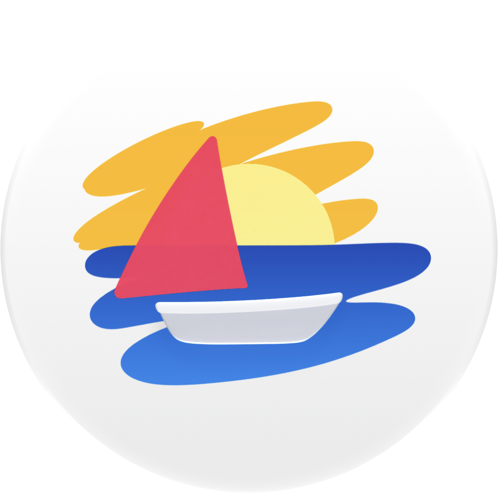

<p align="center">
  
</p>

<h1 align="center">Paint Anytime</h1>

<p align="center">
  A drawing app made specifically for Apple Watch.
</p>

<p align="center">
  Sketch an idea, doodle while you're waiting, or create a tiny piece of art right from your wrist.
</p>

<!-- <p align="center">
  <a href="https://apps.apple.com/app/paint-anytime/id6816100087?platform=watch">
    
  </a>
</p> -->

<p align="center">
  <a href="https://apps.apple.com/app/paint-anytime/id6816100087?platform=watch">
    
  </a>
  &nbsp;&nbsp;
  <a href="https://testflight.apple.com/join/ByhPwH11">
    
  </a>
</p>

<p align="center">
  <a href="https://github.com/denis-kolchev/Paint-Anytime/releases/latest">
    <strong>Latest Release</strong>
  </a>
</p>

## Screenshots

<table>
  <tr>
    <td align="center">
      
    </td>
    <td align="center">
      
    </td>
    <td align="center">
      
    </td>
    <td align="center">
      
    </td>
  </tr>

  <tr>
    <td align="center">
      
    </td>
    <td align="center">
      
    </td>
    <td align="center">
      
    </td>
    <td align="center">
      
    </td>
  </tr>
</table>

## Description

Paint Anytime is for anyone who wants to draw anywhere, anytime. A vector canvas with no loss of quality, 8 brushes, layers, lasso, perspective guides and shape recognition — and Apple Intelligence turns your sketch into a detailed artwork.

It suits both first-time artists and those who draw every day: the interactive tutorial covers the basics in a couple of minutes, and the advanced tools will be waiting whenever you're ready.

## Features

### BRUSHES AND TOOLS
* 8 brushes familiar from the Apple ecosystem — each with its own behavior
* Adjust color, sensitivity and opacity
* Tilt angle for the reed pen
* Blur brush: strength, width and radius
* An eraser that works pixel by pixel or removes whole objects
* 14 color blending modes for strokes
* Shared width, density and color across all tools — if you like

### COLOR AND PALETTES
* Color wheel, eyedropper, HSB and RGB
* Your own palettes: add, delete and reorder colors and the palettes themselves
* Unique palette names inspired by their colors
* Hide built-in and custom palettes you don't use

### LAYERS AND LASSO
* Create, delete and reorder layers
* Opacity, visibility and layer lock — color without going outside the lines
* Lasso selection by shape or by stroke
* Move, rotate, mirror and duplicate a selection
* Move a selection to another layer or delete it

### SMART HELPERS
* Apple Intelligence: from sketch to detailed artwork
* Recognition of 15 shapes: line, arc, circle, ellipse, square, rectangle, triangle, polygon, star, heart, cloud, callout and three kinds of arrows
* Perspective guides with 0, 1 or 2 vanishing points, even beyond the canvas
* Adjust the angle, tilt, number of rays and distance between vanishing points
* Straight lines along a ray or a ruler
* Up to 256 undo steps

### REFERENCE
* Keep a reference image next to the canvas or overlay it and switch back
* Pick colors right from the reference with the eyedropper
* Zoom up to 800%, kept when you return to the canvas
* Show and hide the reference with a single tap

### CANVAS
* Zoom up to 51,200%
* Size up to 2056 × 2056 pixels
* Resize by percentage or by width and height, keeping proportions
* Extend horizontally and vertically, rotate and crop
* Vector drawings scale without losing quality (except blurred areas)
* Three display modes: Smooth (vector), Pixels (as in the final file) and Auto
* Your own layout: arrange and group buttons, pick a group icon from 20 options, or reset everything

### GALLERY AND FILES
* Grid from 5×5 to 1×1
* Favorites, editing and deleting
* Share via Messages and Mail right from your watch
* Select several artworks at once to favorite, share or delete them
* Sync with your iPhone gallery
* Import from Photos and Files
* PSD, JPG, PNG and the native .paintanytime format

### AUTOSAVE
* Your work is saved in the background
* Interval from 1 to 10 minutes
* Show or hide the autosave timer

### WIDGETS
* Quick access: open the app, the gallery or jump straight to a new canvas
* Your artwork on the Home Screen: random drawings from the gallery or favorites, 1 to 3 per widget

### TUTORIAL
* Interactive lessons with hints
* Basic course: how to change color and brush and save a drawing to the gallery
* Advanced course: color blending, lasso, layers, shape recognition, canvas editing, creating colors and palettes
* Progress is saved — pick up right where you left off

### MORE
* iPhone Duo support


## What's New in 1.2.0

### New Features

- New Pencil and Crayon brushes to better express the texture;
- Blur brush for softening edges and better gradient;
- iPhone companion app to display, upload, download, delete, and share projects;
- Updates gallery animations to optimize for more content, and it is ported to iPhone;
- Autosave to make you less worry about battery drain;
- Rotate, crop and change Canvas size;
- Canvas Editor lets you choose and arrange on-canvas controls;
- Shape recognition understands more shapes, including clouds;
- Leading lines to easier draw the perspective images;
- Tutorial is separated on levels to get into the business faster (atwork);
- Allows to change your pictures from your gallery on your watch (atwork);
- Lets you put other image new by Canvas as reference (atwork);
- Apple Intelligence turns your sketch into picture.

### Bug Fixes

- Drawing area now extends under the system clock;
- Faster Undo and Redo.
- Faster Fill tool.
- Smoother movement of objects selected with the Lasso.
- Much smoother zoom in the gallery, without freezes, lag or jumps between grid sizes.
- Fixed mistakes in the tutorial.

## Requirements

- watchOS 10.0 or later
- iOS 17 or later
- iOS 18.2 or later for Apple Intelligence feature 
- Xcode with watchOS development support for building from source

## Build from Source

Clone the repository:

```bash
git clone https://github.com/denis-kolchev/Paint-Anytime.git
```

Open the project in Xcode, select your Apple Developer Team under **Signing & Capabilities**, select an Apple Watch or watchOS Simulator as the destination, and build the project.

Depending on your signing configuration, you may need to use your own Bundle Identifier.

## Releases

Release builds and source archives are available on GitHub:

[View Paint Anytime releases →](https://github.com/denis-kolchev/Paint-Anytime/releases)

Source archives for each release are generated automatically by GitHub.

## Documentation

- [Privacy Policy](docs/PRIVACY.md) — local data, sharing, Photos, and support
- [Contributing](docs/CONTRIBUTING.md) — pull requests and contributor agreement
- [Licensing](docs/LICENSING.md) — source code and official App Store builds

## License

Copyright © 2026 Denis Kolchev.

The source code of Paint Anytime is open source and licensed under the GNU Affero General Public License version 3 only (`AGPL-3.0-only`), unless explicitly stated otherwise. See [LICENSE](LICENSE) for the full terms.

Official builds distributed by Denis Kolchev through the Apple App Store are licensed separately under the [Apple Standard EULA](https://www.apple.com/legal/internet-services/itunes/dev/stdeula/).

Third-party components retain their applicable licenses.

See [LICENSING.md](docs/LICENSING.md) for additional licensing information.
